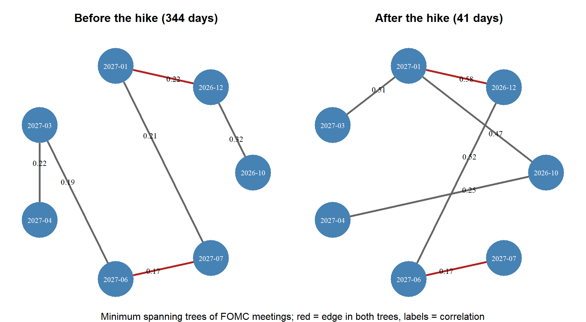

# FOMC Belief Networks

[](https://github.com/BK5102/fomc-belief-networks/actions/workflows/tests.yml)

**Do prediction-market traders price upcoming Fed meetings as separate bets, or as one connected forecast of the rate path? And did that change when the Fed hiked?**

This project treats each upcoming FOMC meeting as a node in a network. It builds the network from daily Kalshi prediction-market prices, keeps the strongest links with a minimum spanning tree (MST), and compares the network before and after the Federal Reserve's 25 bp hike on 2026-09-16.

It began as a course project for DAT 301 (Exploring Data in R and Python) at Arizona State University, Fall 2026. A follow-up added stronger tests, and those tests changed the main conclusion. Both stages are in this repository.



## Findings

**Submitted report** ([`track2_report.Rmd`](track2_pipeline/report/track2_report.Rmd), tag `v1.0-submitted`)

- Before the hike, the tree is a chain of weak links (correlations of daily changes 0.17 to 0.32) with no hub.
- After the hike, correlations roughly double (up to 0.58), January 2027 becomes a mild hub, and the trees share 2 of 6 edges (permutation p = 0.55).
- A tree from the last 41 days before the hike shared 5 of 6 edges with the full before tree, which suggested that the change was real and not caused by the short after window.
- The hike was expected (87% priced the day before). Afterwards traders pushed expected hikes into 2027 (March 2027 went from about 0 to 13 bp).

**Follow-up** ([`extensions.Rmd`](track2_pipeline/report/extensions.Rmd))

- **No change in network structure can be detected.** I built a tree from every 41-day block of the before period and compared it with a tree from the rest of that period. 89% of those comparisons share 2 edges or fewer. Two samples from the *same* regime agree no more than the before and after trees do. The report's 41-day check was an outlier: only 2 of 304 blocks reach 5 shared edges.
- **The "stronger links" contrast is a liquidity trend, not a hike effect.** 56% of 41-day blocks from before the hike have links at least as strong as the after window. Stale quoting in far meetings fell from about 90% of days in late 2025 to about 5% by September 2026, before the hike. That dilutes the average of the long before window.
- **Single trees are noisy.** In a moving-block bootstrap, only one edge per window appears in at least 80% of resampled trees. Changes to cleaning choices (spread filter, forward-fill limit, leg coding) move 1 to 4 of the 6 edges.
- **An off-the-shelf test misleads here.** The Jennrich test of equal correlation matrices gives p = 1.6e-7 for before vs after. It also rejects for every pair of samples taken from inside the before period, so it carries no information on this data.
- **A date bug was fixed with no effect on results.** The report's timestamp conversion put one candle per leg on the wrong day at the March 2026 daylight-saving switch. Fixing it changes one correlation by 0.07 and leaves both trees unchanged.

What still holds: the MST approach is a clear way to summarize meeting-to-meeting links, the before chain links mostly neighboring meetings, and the hike was priced in ahead of time. What does not hold: the claim that the network reorganized after the hike. 41 days of data and 7 nodes are too few to detect that.

## Method

```
Kalshi public API (KXFEDDECISION, 8 meetings x 5 legs, 13,211 daily candles)
  -> trading dates (fixed UTC-5 clock; candles end at midnight US Eastern)
  -> one price per leg per day (bid/ask midpoint; quotes wider than 20 cents treated as missing)
  -> forward-fill gaps up to 5 days; drop decision-day settlement prices
  -> expected move per meeting per day = sum(p x move) / sum(p), in basis points
     (days where the 5 legs sum outside 0.80 to 1.20 are dropped)
  -> daily changes, split at the hike: before (344 days) and after (41 days)
  -> 7 x 7 correlation matrix per window
  -> distance d = sqrt(2 (1 - rho))  ->  minimum spanning tree (igraph, Kruskal)
  -> compare: shared edges (exact permutation test over all 5,040 relabellings), degree,
     same-regime block null, block bootstrap, rolling windows, robustness variants
```

Nodes are the seven meetings from October 2026 to July 2027. Each meeting has five legs: cut more than 25 bp, cut 25, hold, hike 25, and hike more than 25, coded as -50, -25, 0, +25 and +50 bp.

## Repository layout

```
track2_pipeline/
  R/pull_kalshi.R             downloads raw Kalshi data (httr2 + jsonlite, public endpoints, no key)
  R/wrangle.R                 raw candles -> daily expected-move panel and daily changes
  R/graph.R                   correlations, MSTs, permutation tests, block null, bootstrap, rolling trees
  report/track2_report.Rmd    submitted report: wrangling, EDA, graph analysis, conclusions (+ .html)
  report/extensions.Rmd       follow-up checks described above (+ .html)
  report/track2_slides.Rmd    slides for the 10-minute course presentation (+ .html)
  report/figures/             figures saved by the reports
  tests/testthat/             unit tests, plus a regression test that R/ reproduces the submitted report
  run_all.R                   download (if needed), test and knit everything
  DESCRIPTION, renv.lock      package dependencies and pinned versions (R 4.4.2)
  data/meetings.csv           FOMC decision and effective dates, 2025-01 to 2028-01 (2027+ tentative)
  py/, tests/*.py, R/analysis.R
                              earlier Python prototype (Kalshi, Polymarket and Fed funds futures pullers,
                              futures least-squares conversion) and a generic MST comparison script
CONCEPTS.md                   plain-language glossary: Fed basics, prediction markets, statistics, graph theory
```

## Reproduce

The raw Kalshi data is **not included**, because Kalshi's terms do not allow republishing it. The download script fetches the same snapshot.

```bash
cd track2_pipeline
Rscript -e 'install.packages("renv"); renv::restore()'   # or install the packages listed in DESCRIPTION
Rscript run_all.R                                        # ~2 min: downloads data, runs tests, knits all reports
```

`R/pull_kalshi.R` defaults to an end date of 2026-10-29, which matches the original pull. A re-download on 2026-11-14 matched the original on every row, except for candle timestamps at the two daylight-saving switches (Kalshi now stamps them differently) and the partial last day. Neither affects the analysis, which ends on 2026-10-27. Knitting outside RStudio needs pandoc on the PATH, or `RSTUDIO_PANDOC` set to RStudio's pandoc folder.

GitHub Actions runs the unit tests on every push. The regression test needs the raw data, so it runs only locally.

## Limitations and next steps

- The after window has only 41 trading days. Re-running the analysis with more post-hike data is the most direct next step.
- Only one market is used. A Fed funds futures (CME ZQ) comparison was planned, but it needs daily prices for contracts that have since expired, which free sources now offer only as manual downloads.
- 2027 meetings trade on 20 to 43% of days, and FOMC dates from 2027 on are tentative.
- The "more than 25 bp" legs are coded as exactly 50 bp; the trees shift when they are coded as 75 bp.

## References

- Board of Governors of the Federal Reserve System. *Meeting calendars, statements, and minutes.* https://www.federalreserve.gov/monetarypolicy/fomccalendars.htm
- Jennrich, R. I. (1970). An asymptotic chi-square test for the equality of two correlation matrices. *Journal of the American Statistical Association*, 65(330), 904-912.
- Kalshi. *Kalshi API documentation.* https://docs.kalshi.com
- Kruskal, J. B. (1956). On the shortest spanning subtree of a graph and the traveling salesman problem. *Proceedings of the American Mathematical Society*, 7(1), 48-50.
- Mantegna, R. N. (1999). Hierarchical structure in financial markets. *The European Physical Journal B*, 11(1), 193-197.

## License

Code is released under the MIT License (see `LICENSE`). Kalshi market data is subject to Kalshi's terms and is not distributed here.
