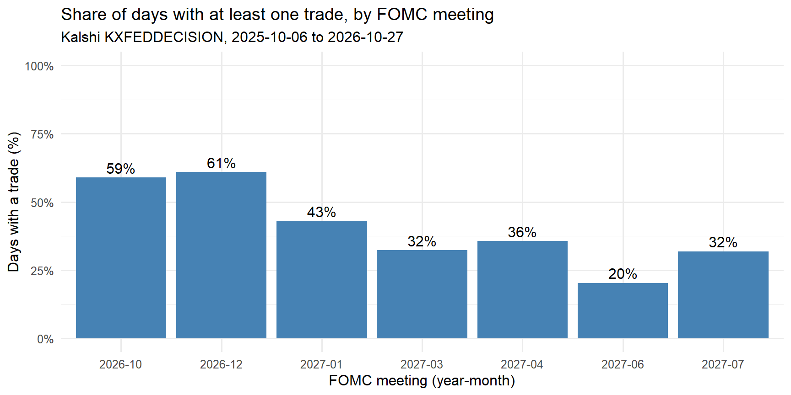
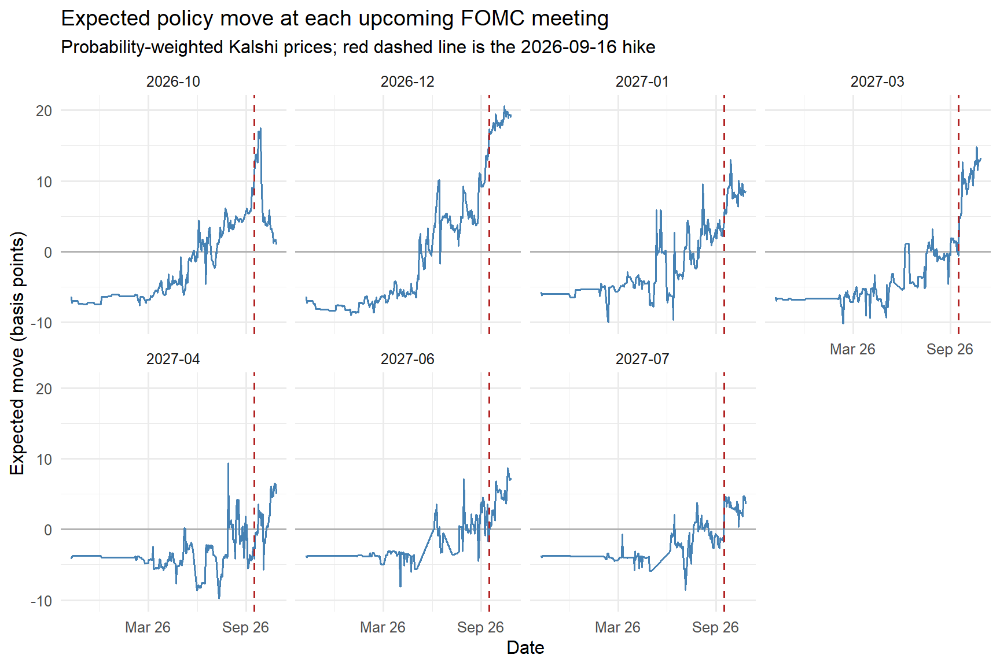
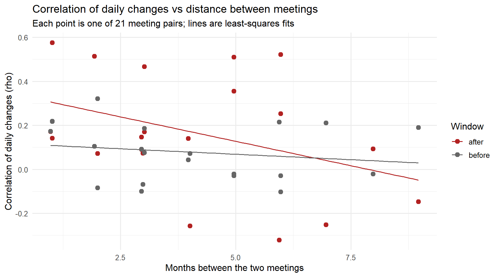
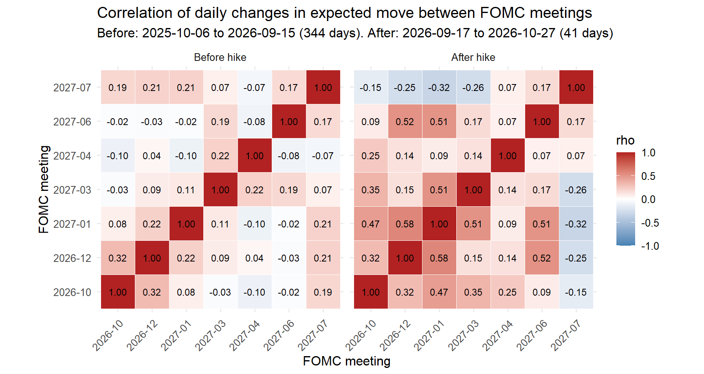
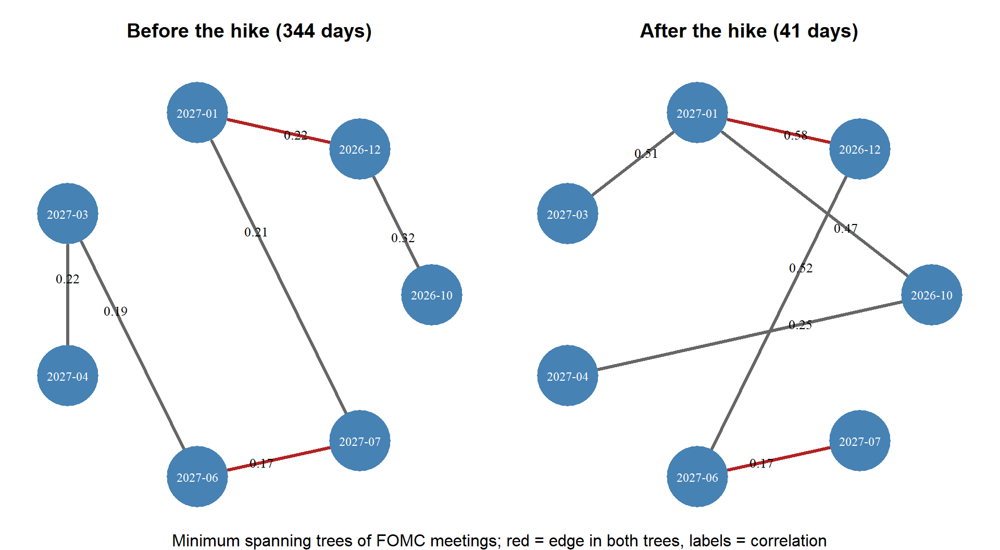
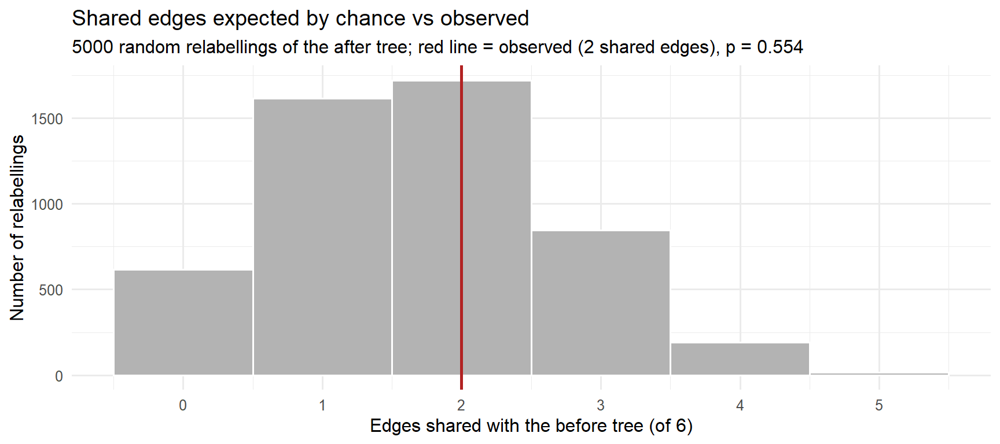

<!-- Knit track2_report.Rmd first: these slides reuse the PNG files it saves in figures/. -->

```{r setup, include = FALSE}
knitr::opts_chunk$set(echo = FALSE, out.width = "100%")
```

## The question

- The Fed's FOMC meets about 8 times a year and can **hike**, **cut** or **hold** rates
- On Kalshi, each meeting is a market; a price of $0.70 means a 70% chance
- Beliefs about different meetings should be connected

**Which future meetings do traders treat as linked, and did that change after the Fed hiked on September 16, 2026?**

## Data

- Kalshi public API, series `KXFEDDECISION`, downloaded in R (`httr2`)
- 8 meetings, 40 contracts ("legs"), 13,211 daily records
- 5 legs per meeting: cut >25, cut 25, hold, hike 25, hike >25 bp
- One number per meeting per day: **expected move** = sum(probability x move)
- Network: 7 meetings, Oct 2026 to Jul 2027
- Before window: Oct 2025 to Sep 15, 2026 (344 days). After: Sep 17 to Oct 27, 2026 (41 days)

## Cleaning in 6 steps

1. Timestamps to US Eastern dates
2. Price = midpoint of bid and ask; drop quotes wider than 20 cents
3. Attach the Fed calendar; drop decision days
4. Carry prices forward over gaps of up to 5 days
5. Expected move per meeting per day; drop days where legs sum outside 0.80 to 1.20
6. Daily changes, split into before and after windows

A one-sided quote (bid $0.00, ask $0.48) had created a fake 15 bp jump; step 2 removes it.

## EDA 1: far meetings rarely trade

```{r}

```

## EDA 2: the hike was expected, but beliefs shifted after it

```{r}

```

Hike priced at 87% the day before. Afterwards, expected hikes moved into 2027.

## EDA 3: after the hike, nearby meetings move together

```{r}

```

## Correlations before vs after

```{r}

```

## From correlation to a tree

- Distance: d = sqrt(2(1 - rho)), so strong links are short
- 7 meetings, 21 possible links
- **Minimum spanning tree**: keep the 6 shortest links that connect everything without a loop (Kruskal's algorithm)
- Compare the trees: shared edges, permutation test, degree

## The two trees

```{r}

```

## Did the structure survive the hike?

```{r}

```

2 of 6 edges shared, no more than chance (p = 0.55). A tree from the last 41 days before the hike shares 5 of 6 with the full before tree.

## Conclusions

- **Before the hike:** a chain of weak links; each meeting moves with its neighbor, no hub
- **After the hike:** links twice as strong; the tree reorganises around January 2027
- The hike was expected, so this is not a shock reaction; traders started pricing a *path* of hikes
- **Limitations:** 41-day after window, thin trading in 2027 meetings, one market only
- **Next:** compare with Fed funds futures; rolling windows; CPI and jobs markets

## Thank you

Questions?

Code and data: `track2_pipeline/` (R scripts, raw CSVs, report source)
